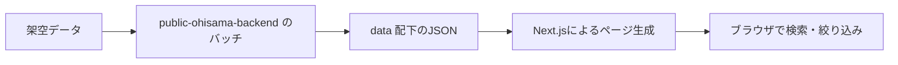

# public-ohisama-portal

架空の人物・番組・動画を使った公開用ポータルです。
本番の画面構成を参考に、検索、種別・メンバー絞り込み、URLによる条件の復元、期限別表示、お気に入り、テーマ切り替えを実装しています。
掲載内容とリンクはすべてデモ用です。

## 起動

Node.jsのバージョンは `.nvmrc` と `package.json` の `engines` に合わせます。

```sh
npm ci
npm run dev
```

`http://localhost:3000` を開きます。バックエンドの起動やAPIキーは必要ありません。
公開先URLを変えるときだけ `.env.example` を参考に `NEXT_PUBLIC_SITE_URL` を設定します。

```sh
npm run build
npm run start
```

## データの流れ



JSONを直接importするファイル配信方式です。フロントからバックエンドAPIは呼びません。
生成済みのサンプルを同梱しているため、このリポジトリ単独でも動作します。
同じ親フォルダにバックエンドを配置した場合、次のコマンドで更新できます。

```sh
python ../public-ohisama-backend/pipeline.py --output data
```

`data/demo.json` の `referenceTime` を基準に期限を表示します。
実際の今日の日付でサンプルが消えることを避け、サーバーとブラウザで同じ表示を再現します。
`expiresAt` はタイムゾーン付きの明示的な値です。本番の説明文解析・補正・タグ付与条件は使用しません。

## 主な機能

- `/almost-over`: 固定したデモ日時から7日以内に終了するコンテンツ。終了済みは除外。
- `/all`: 全サンプルの検索とページ切り替え。
- `/:type` / `/:type/member/:member`: 種別・メンバー別のURL。例: `/all/member/sample-aoi`。
- お気に入り: ダイアログで選択し、ブラウザ内で絞り込み。設定をURLやサーバーへ送信しません。
- テーマ: 明色／暗色をブラウザ内で保持。
- canonical、OGP、構造化データ、sitemap、レスポンシブ表示。

ファイル配信で保守負担を抑え、データ生成と表示を分離する設計を引き継いでいます。
この公開版では外部収集、実データ、独自の人物判定、実サービス用のURL処理、SNS投稿、アクセス解析を省いています。
画像はローカルSVG、外部コンテンツへのリンクは `example.com` に限定しています。
サービス名は分類例です。実在する人物・番組・配信状況を表しません。
インストール用manifestはありますが、オフライン機能を含む本番PWA全体の再現ではありません。
AWS構成への移行やAthena分析は将来の検討事項で、この公開版の実装実績には含めません。

## 検証と公開用書き出し

公開用検査にはPython 3.12以降を使用します。

```sh
python scripts/verify_public.py
npm run build
npm run typecheck
npx playwright install chromium
npm run test:e2e
```

Playwrightはビルド済みの本番モードで、デスクトップとモバイルの検索、URL復元、期限表示、お気に入り、テーマを確認します。
CIは検証だけを実行します。本番データの取得・更新や、他リポジトリへのpushは行いません。

`public-files.json` の許可リストと、ソース・設定・画像・データ・ドキュメント全体の検査を使います。
ファイル追加時は内容を確認してから許可リストを更新してください。
文字列検査には限界があるため、公開前の差分レビューも必要です。

```sh
python scripts/export_public.py --output ../public-portal-export
```

新規フォルダへ許可ファイルだけを書き出し、既存フォルダには上書きしません。
既存リポジトリのGit履歴は別途確認が必要です。書き出しに履歴は含まれません。
本番用の古い公開同期スクリプトで、このリポジトリを上書きしないでください。
